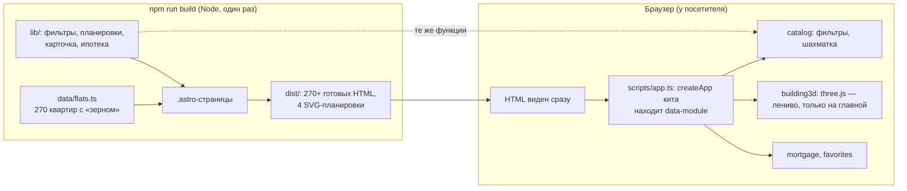

# 00. С чего начать

Этот учебник для человека, который знает HTML, CSS и немного JavaScript/TypeScript, но ещё не делал
сайтов на **Astro** и не трогал **three.js**. Здесь — как сделать сайт жилого комплекса, который
грузится мгновенно, находится поисковиками и при этом показывает 3D-квартал и подбор квартир.

## Как устроена каждая глава

1. **Зачем** — что видит человек и какую задачу решаем.
2. **Самый маленький пример** — несколько строк, которые можно понять целиком.
3. **Как это сделано в «Соснах»** — настоящий код с разбором.
4. **Ошибки** — что ломается у всех в первый раз.
5. **Попробуйте сами** — задания с ответами под спойлером.

## Картинка целиком: где выполняется какой код

Главная мысль: **большая часть работы сделана при сборке**. 270 страниц квартир, шахматка,
планировки — готовый HTML. В браузер уходит JavaScript только для интерактива, и тот — лениво.
Одни и те же функции из `lib/` работают и при сборке (Astro), и в браузере (модули), и в тестах.

## Словарь в одну строку

| Слово | Простыми словами | Пример в проекте |
| --- | --- | --- |
| **Astro** | Фреймворк, который собирает страницы в готовый HTML и по умолчанию не шлёт JS | `src/pages/*.astro` |
| **Статическая сборка** | Все страницы делаются заранее, сервер только отдаёт файлы | `npm run build` → `dist/` |
| **`getStaticPaths`** | «Какие страницы сделать по этому шаблону» | 270 квартир из одного `[id].astro` |
| **Эндпоинт** | Файл, который при сборке выдаёт не HTML, а другой файл | `plans/[layout].svg.ts` |
| **`set:html`** | Вставить HTML-строку в шаблон Astro | карточка квартиры |
| **Модуль кита** | Функция, оживляющая блок по `data-module` | `catalog`, `mortgage` |
| **Ленивый модуль** | Код скачивается, только если блок есть на странице | `building3d` + three.js |
| **Генератор с зерном** | «Случайные» числа, одинаковые при каждом запуске | `seeded(2027)` |
| **three.js** | Библиотека 3D в браузере поверх WebGL | `scene.ts` |
| **Меш** | 3D-объект: геометрия (форма) + материал (вид) | башня |
| **`CanvasTexture`** | Картинка, нарисованная кодом, как текстура 3D-объекта | фасад с окнами |
| **`emissiveMap`** | Карта свечения: какие места объекта светятся сами | горящие окна |
| **`InstancedMesh`** | Один объект, нарисованный много раз за один вызов | 400 сосен |
| **Raycaster** | «Луч» из камеры через курсор: что под мышью | подсказка над башней |
| **Шахматка** | Таблица «башня × этаж × квартира», привычная на сайтах застройщиков | `Chess.astro` |
| **Аннуитетный платёж** | Одинаковый ежемесячный платёж по ипотеке | `calcMortgage` |
| **`replaceState`** | Поменять адрес без новой записи в истории | фильтры каталога |
| **Делегирование** | Один обработчик на родителе вместо обработчика на каждой кнопке | ♥ избранного |

## Как читать код проекта

- **Комментарий в начале каждого файла** объясняет «зачем» и «почему так».
- **`kit/`** — шаблон [frontend-kit](https://github.com/dmitriy9427/frontend-kit) со своим учебником.
- **Ищите по тексту на экране:** «Найдено: 52 квартиры» → `modules/catalog/index.ts`.

## Порядок чтения

| Если вы хотите… | Читайте |
| --- | --- |
| понять, почему Astro и как разложено | [01. Архитектура](01-architecture.md) |
| 3D без моделей | [02. 3D-квартал](02-building3d.md) |
| фильтры, шахматку, 270 страниц | [03. Каталог](03-catalog.md) |
| калькулятор и избранное | [04. Ипотека и избранное](04-mortgage-favorites.md) |
| публикацию | [05. Деплой](05-deploy.md) |
| понять конкретный файл | [Разбор кода](code/README.md) |
